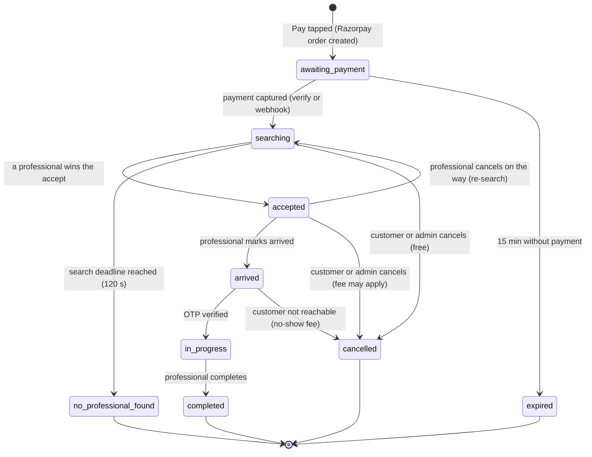
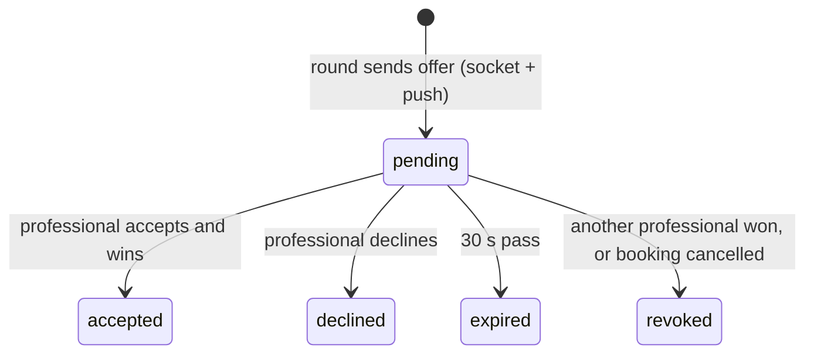
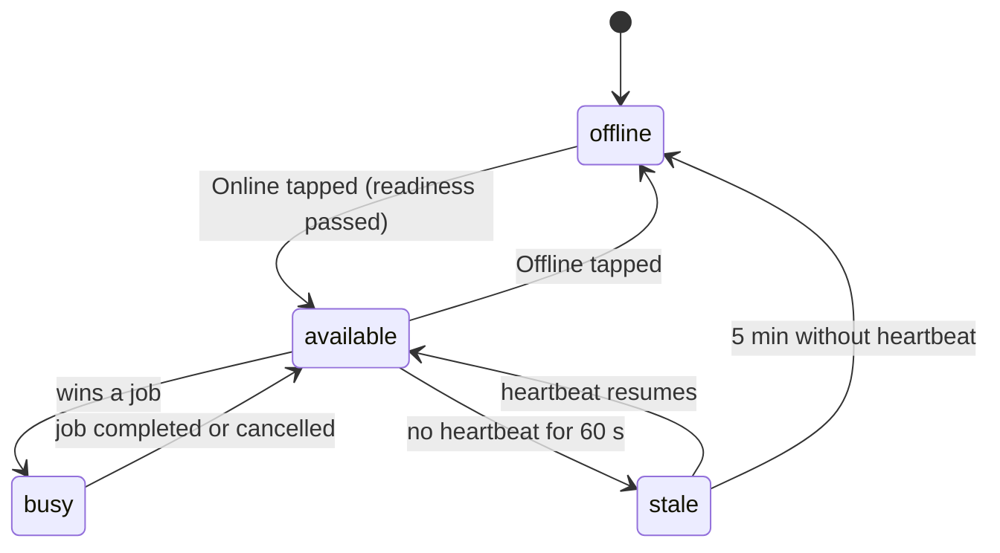

# State machines

These are the only allowed states and transitions. Every transition:
- is a single conditional atomic update (`status` must equal the expected previous state);
- is appended to `statusHistory` and the audit trail;
- is announced on the booking's socket room.

Critical side effects (refunds, emails) go through the outbox (ADR-0007).

## Booking

| From → To | Trigger | Guard | Side effects |
|---|---|---|---|
| — → awaiting_payment | `POST /v1/bookings` | Valid quote; items active; within hours; idempotency key | Price snapshot; Razorpay order; `paymentExpiresAt` = now + 15 min |
| awaiting_payment → searching | Verify or `payment.captured` | Signature valid; amount matches; not already processed | Search starts (round 1, `deadlineAt` = now + 120 s); payment recorded |
| awaiting_payment → expired | Sweeper | Unpaid at `paymentExpiresAt` | None. A capture that arrives later is refunded automatically. |
| searching → accepted | Offer accept | Transaction: professional free AND booking still searching | Other offers revoked; OTP generated; phones and location released; confirmation email (outbox); ETA via Routes |
| searching → no_professional_found | Sweeper at deadline | No accept | Full instant refund (outbox); customer email; admin alert |
| searching → cancelled | Customer or admin | — | Offers revoked; full refund |
| accepted → arrived | Professional | Within 200 m, or explicit confirmation | Customer notified in page |
| accepted → searching | Professional cancels | Reason given | Professional released and excluded; new deadline; customer told; cancellation counted in stats |
| accepted → cancelled | Customer or admin | Fee by policy (free if the professional is late) | Partial or full refund; professional released |
| arrived → in_progress | OTP | Correct OTP, attempts < 5 | Service timer starts |
| arrived → cancelled | Professional: customer not reachable | 10-minute wait + 2 logged calls | No-show fee; partial refund |
| in_progress → completed | Professional | Confirmation if < 50% of the expected duration | Invoice number; earnings; phones hidden; location stops; review request |

**Flag, not a state:** `late` is set when the time passes the ETA plus 10 minutes and the professional hasn't arrived. It triggers an admin alert and makes cancellation free.

## Offer

## Professional presence

## Timers (all restart-safe; ADR-0007)
| Timer | Field | Default | On expiry |
|---|---|---|---|
| Offer window | `offers.expiresAt` | 30 s | Offer → expired; maybe next round |
| Search deadline | `bookings.search.deadlineAt` | 120 s | → no_professional_found |
| Unpaid order | `bookings.paymentExpiresAt` | 15 min | → expired |
| Late arrival | `bookings.lateAt` | ETA + 10 min | Set `late`; admin alert |
| Presence | `presence.lastHeartbeatAt` | 60 s / 5 min | stale / offline |
| Outbox retry | `outbox.nextAttemptAt` | Exponential backoff | Retry the dispatch |

## Invariants (tested)
1. A professional has at most one active booking (`accepted`, `arrived` or `in_progress`).
2. A booking has at most one accepted offer and one assigned professional.
3. A captured payment never ends without one of these:
   - a completed booking;
   - a refund;
   - an open admin alert.
4. Phone numbers are released only between `accepted` and completion or cancellation. Live location only in `accepted` and `arrived`.
5. Money is integer paise everywhere, and the stored totals always add up.
