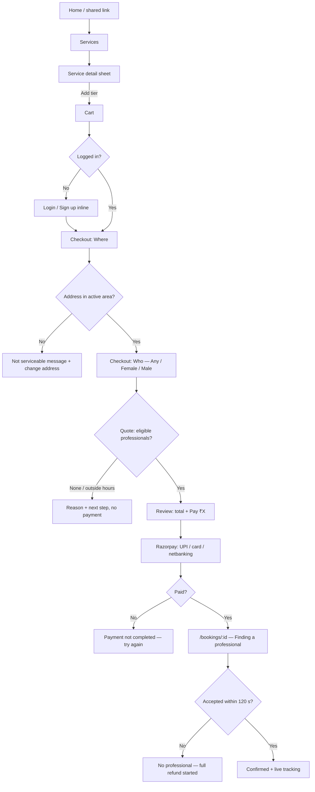
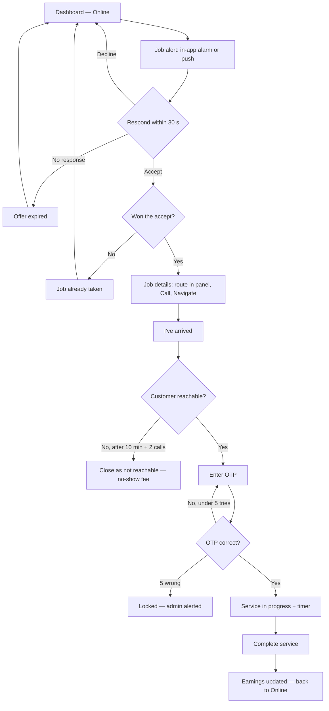
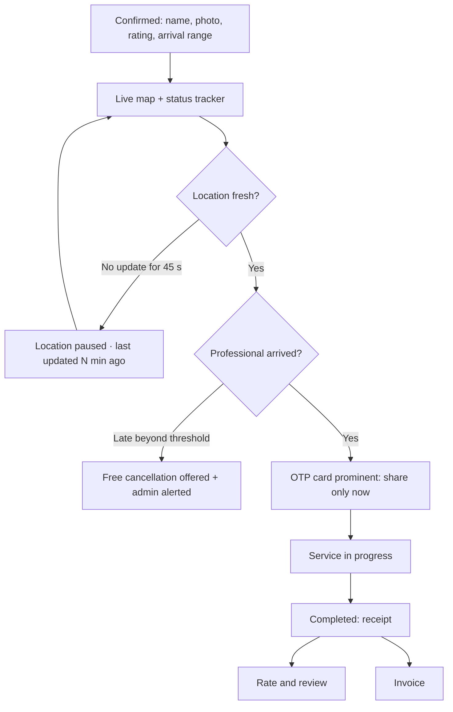
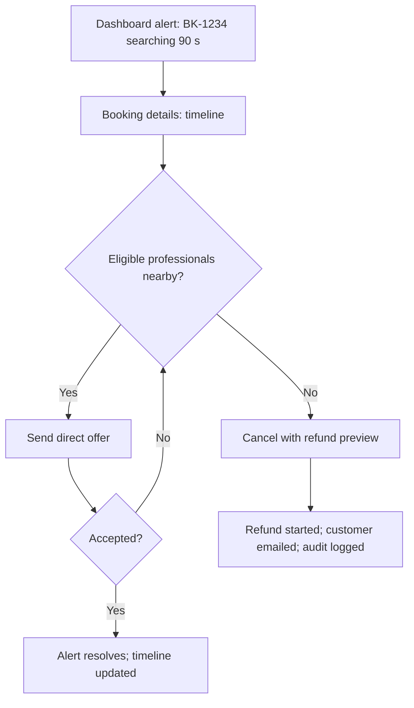

# Wireflows (low fidelity)

There are four core journeys. Screens are boxes and decisions are diamonds. Every screen named here has its full states listed in `requirements.md`.

## 1. Customer books (happy path in bold)

## 2. Professional receives and does a job

## 3. Customer tracks, shares OTP and finishes

## 4. Admin intervenes

